# Tasker.md – Handbuch

Stand: Version 0.2.0. Alle Bilder zeigen den erfundenen Beispiel-Vault aus [`examples/demo-vault`](../examples/demo-vault).

## Inhalt

1. [Was ist Tasker.md?](#1-was-ist-taskermd)
2. [Installation und erster Start](#2-installation-und-erster-start)
3. [Aufgaben im Vault](#3-aufgaben-im-vault)
4. [Die Oberfläche im Überblick](#4-die-oberfläche-im-überblick)
5. [Heute](#5-heute)
6. [Dashboard](#6-dashboard)
7. [Projekte](#7-projekte)
8. [Demnächst](#8-demnächst)
9. [Jira](#9-jira)
10. [Aufgaben bearbeiten](#10-aufgaben-bearbeiten)
11. [Schnelleingabe](#11-schnelleingabe)
12. [Eigene Filter](#12-eigene-filter)
13. [Fokus-Timer und Fokus-Zeiten](#13-fokus-timer-und-fokus-zeiten)
14. [Erinnerungen und Tagesbriefing](#14-erinnerungen-und-tagesbriefing)
15. [Infobereich, Autostart und globales Tastenkürzel](#15-infobereich-autostart-und-globales-tastenkürzel)
16. [Google Kalender verbinden](#16-google-kalender-verbinden)
17. [Einstellungen](#17-einstellungen)
18. [Tastenkürzel](#18-tastenkürzel)
19. [Wo liegen meine Daten?](#19-wo-liegen-meine-daten)
20. [Häufige Fragen](#20-häufige-fragen)

---

## 1. Was ist Tasker.md?

Tasker.md ist ein Dashboard für einen [Obsidian](https://obsidian.md)-Vault, der nach **GTD** (Getting Things Done) organisiert ist. Die Aufgaben stehen als ganz normale Markdown-Zeilen in deinen Notizen. Tasker.md liest sie, ordnet sie in Ansichten wie „Heute“ oder „Nächste Aktionen nach Kontext“ und blendet Jira-Tickets und Kalendertermine dazu ein.

**Der Vault bleibt die einzige Quelle.** Tasker.md hat keine eigene Datenbank für Aufgaben. Was du in Obsidian änderst, sieht Tasker.md sofort, und umgekehrt.

**Was Tasker.md in deinen Notizen ändert, und wie:**

- Nur die betroffene Zeile, z. B. beim Abhaken `[x]` und ` ✅ 2026-11-11`. Neue Aufgaben kommen als neue Zeile dazu.
- Vor jedem Schreiben liest die App die Zeile neu. Hat sie sich inzwischen geändert, bricht sie ab und lädt neu, statt etwas zu überschreiben.
- Tasker.md **löscht nie** Dateien oder Inhalte und rührt den Ordner `.obsidian/` nicht an.
- Fast jede Änderung lässt sich direkt danach rückgängig machen.

Jira und Google Kalender werden **nur gelesen**.

## 2. Installation und erster Start

### Installieren

Die Installer liegen unter [Releases](../../../releases):

| System | Datei | Hinweis |
|---|---|---|
| Windows 10/11 | `.msi` oder `.exe` | SmartScreen warnt beim ersten Start, weil der Installer nicht signiert ist: „Weitere Informationen“ → „Trotzdem ausführen“. |
| macOS (Apple Silicon und Intel) | `.dmg` | Nach dem Kopieren nach „Programme“ einmal im Terminal `xattr -cr /Applications/Tasker.md.app` ausführen. |

### Erster Start

Beim ersten Start öffnen sich die Einstellungen auf dem Reiter **Vault**.

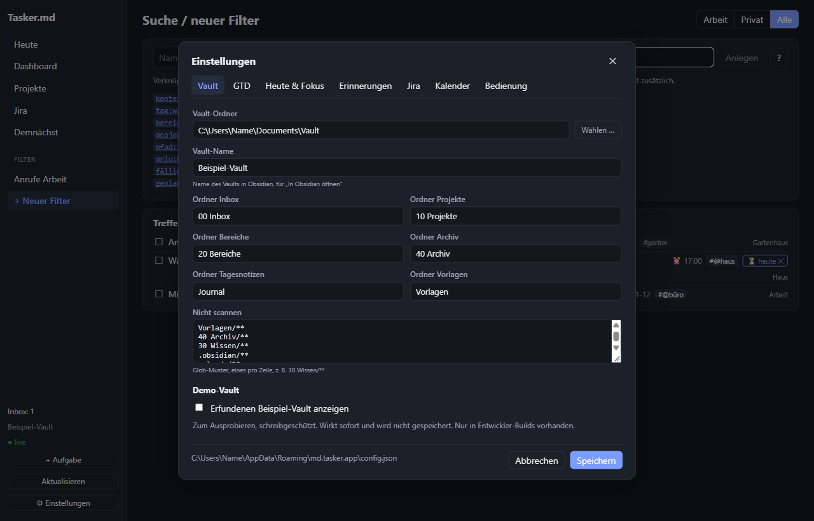

1. **Vault-Ordner** über „Wählen …“ auf deinen Obsidian-Vault setzen.
2. **Vault-Name** so eintragen, wie der Vault in Obsidian heißt. Er wird für „In Obsidian öffnen“ gebraucht.
3. Die **Ordner** an deine Struktur anpassen. Voreingestellt ist eine PARA-ähnliche Ablage mit `00 Inbox`, `10 Projekte`, `20 Bereiche`, `40 Archiv`, `Journal` und `Vorlagen`.
4. Unter **Nicht scannen** Ordner ausschließen, deren Aufgaben nicht erscheinen sollen. Das sind Glob-Muster, eines pro Zeile, z. B. `30 Wissen/**`.
5. **Speichern.** Danach baut die App den Index auf. Unten links steht „● live“, solange sie Änderungen im Vault automatisch übernimmt.

Unten im Dialog steht, wo die Konfigurationsdatei liegt (siehe [Abschnitt 19](#19-wo-liegen-meine-daten)).

## 3. Aufgaben im Vault

### Aufgabenzeilen

Tasker.md versteht die Syntax des Obsidian-Plugins [Tasks](https://publish.obsidian.md/tasks/). Eine Aufgabe ist eine Listenzeile mit Kästchen:

```markdown
- [ ] Angebot Zimmerei Müller einholen #@telefon ⏫ ⏳ 2026-11-12 📅 2026-11-20
```

| Element | Bedeutung |
|---|---|
| `- [ ]` | offen |
| `- [x]` | erledigt |
| `- [/]` | in Arbeit |
| `- [-]` | abgebrochen (zählt wie erledigt, wird nicht angezeigt) |
| `⏳ JJJJ-MM-TT` | geplant (Wiedervorlage): ab diesem Tag auf „Heute“ |
| `📅 JJJJ-MM-TT` | fällig: echter Termin |
| `🛫 JJJJ-MM-TT` | Start |
| `✅ JJJJ-MM-TT` | erledigt am |
| `➕ JJJJ-MM-TT` | erstellt am |
| `🔺 ⏫ 🔼 🔽 ⏬` | Priorität, von höchster bis niedrigster |
| `🔁 every week` | Wiederholung (siehe [10.2](#102-wiederkehrende-aufgaben)) |
| `🆔 gh-a` und `⛔ gh-a` | Abhängigkeit: `⛔` wartet auf die Aufgabe mit dieser `🆔` |
| `⏰ 09:00` | Erinnerung (siehe [Abschnitt 14](#14-erinnerungen-und-tagesbriefing)) |
| `#@telefon` | Kontext: wo oder womit du die Aufgabe erledigen kannst |
| `#warten` | du wartest auf jemand anderen |

**Blockiert** ist eine Aufgabe, solange eine ihrer `⛔`-IDs auf eine noch offene Aufgabe zeigt. Blockierte Aufgaben erscheinen nicht unter „Nächste Aktionen“, sondern unter „Später dran“. Im Beispiel-Vault gilt:

```markdown
- [ ] Dachfläche ausmessen #@haus 🆔 gh-a
- [ ] Dachpappe bestellen #@computer ⛔ gh-a 🆔 gh-b
- [ ] Solarleuchte montieren #@haus ⛔ gh-b
```

Erst wenn „Dachfläche ausmessen“ erledigt ist, wird „Dachpappe bestellen“ zur nächsten Aktion.

### Projekte und Bereiche

- **Projekt:** eine Notiz mit Frontmatter `typ: projekt`. Aufgaben stehen unter `## Nächste Schritte`.
- **Bereich:** eine Notiz mit `typ: bereich`. Aufgaben stehen unter `## Aufgaben ohne Projekt`.

```markdown
---
typ: projekt
status: aktiv          # aktiv | wartend | irgendwann | erledigt
bereich: Haus
review: 2026-11-08     # letzter Review
termin: 2026-12-15     # optional
jira: [ABC-123]        # optional: zugehörige Tickets
tags: [garten]
---
```

**Weitere Regeln:**
- **Tags aus dem Frontmatter** (`tags`) gelten auch für alle Aufgaben der Notiz. Sie erscheinen blasser und zählen für Filter und Kontexte, werden aber nie in die Zeile geschrieben.
- **Tagesnotizen:** Eine Aufgabe ohne eigenes Datum in einer Tagesnotiz (z. B. `Journal/2026-11-11.md`) gilt als an diesem Tag geplant. Auch das ist nur Anzeige.
- **Arbeit und Privat:** Eine Aufgabe zählt zu „Arbeit“, wenn ihr Projekt oder Bereich in den Einstellungen unter „Bereiche, die als Arbeit zählen“ steht oder ihr Pfad unter einem der „Pfade, die als Arbeit zählen“ liegt. Alles andere ist „Privat“.

## 4. Die Oberfläche im Überblick

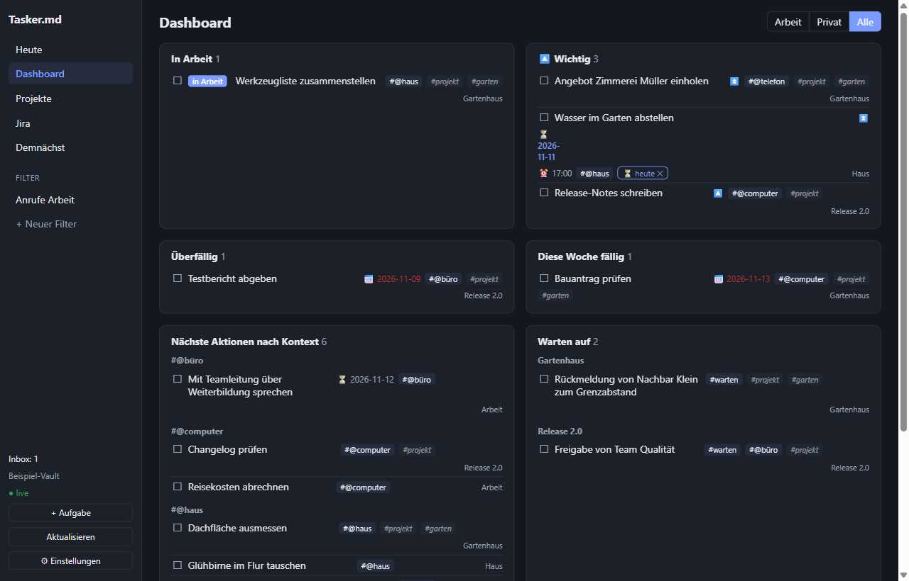

**Seitenleiste (links):**
- Die Ansichten Heute, Dashboard, Projekte, Jira und Demnächst.
- Darunter deine gespeicherten Filter.
- Unten der Inbox-Zähler, der Vault-Name, die Live-Anzeige sowie die Knöpfe **+ Aufgabe**, **Aktualisieren** und **⚙ Einstellungen**.

**Oben rechts** schaltest du zwischen **Arbeit**, **Privat** und **Alle** um. Das gilt für alle Ansichten außer Jira.

**Jede Aufgabenzeile** zeigt:
- das Kästchen zum Abhaken, den Text, Priorität, Daten, Erinnerungen und Tags;
- rechts die Notiz, aus der sie stammt;
- beim Überfahren mit der Maus Knöpfe für „für heute planen“, Fokus-Timer und „in Obsidian öffnen“.

Blass dargestellte Werte (z. B. `#garten` oder ein kursives Datum) sind abgeleitet und stehen nicht in der Zeile.

**Meldungen unten in der Mitte** bestätigen jede Änderung und bieten meist **Rückgängig** an.

## 5. Heute

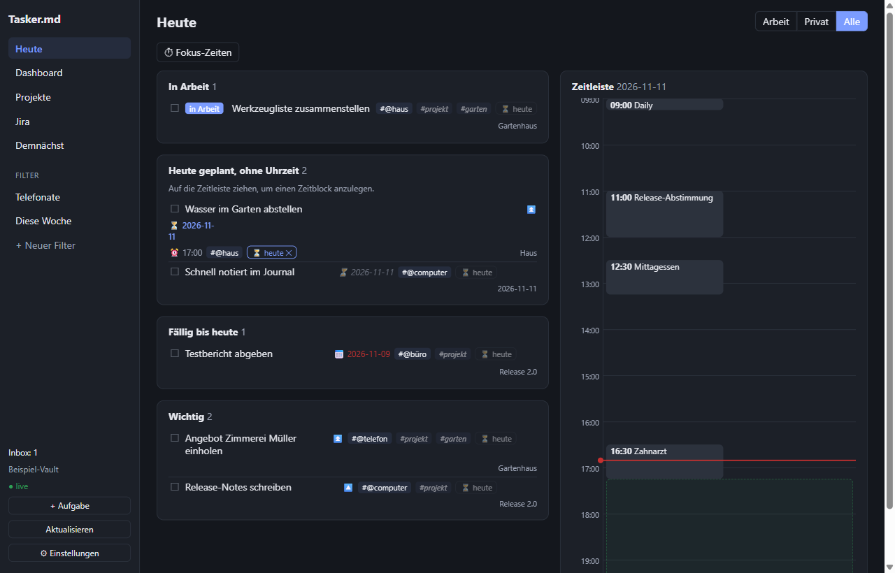

„Heute“ ist die Startansicht für den Tag. Sie besteht aus Listen links und der Zeitleiste rechts.

**Listen links:**
- **In Arbeit:** alle Aufgaben mit `[/]`.
- **Heute geplant, ohne Uhrzeit:** `⏳` heute oder früher. Liegengebliebenes rutscht also mit.
- **Fällig bis heute:** `📅` heute oder überfällig.
- **Wichtig:** Priorität gesetzt, nicht blockiert, nicht schon weiter oben.

**Zeitleiste rechts:**
- Sie zeigt die Termine aus dem Google Kalender und deine Zeitblöcke. Die rote Linie ist die aktuelle Uhrzeit.
- **Zeitblock anlegen:** eine Aufgabe aus der linken Liste auf die Zeitleiste ziehen. Der Block ist zunächst 30 Minuten lang (einstellbar).
- **Länge ändern:** am unteren Rand des Blocks ziehen.
- **Am Block:** abhaken, Fokus-Timer starten (▶) oder den Block entfernen (✕).
- Zeitblöcke liegen nur lokal in der App, nie im Vault.
- Ist die Aufgabe erledigt oder nicht mehr für heute geplant, verschwindet ihr Block. Nicht erledigte Blöcke vom Vortag erscheinen als „liegengeblieben“.

Über **⏱ Fokus-Zeiten** oben öffnest du die Tagesübersicht der Fokus-Zeiten (siehe [Abschnitt 13](#13-fokus-timer-und-fokus-zeiten)).

## 6. Dashboard

Das Dashboard (Bild in [Abschnitt 4](#4-die-oberfläche-im-überblick)) zeigt den GTD-Überblick:

| Abschnitt | Inhalt |
|---|---|
| In Arbeit | `[/]` |
| Wichtig | Priorität gesetzt, nicht blockiert, nach Priorität sortiert |
| Überfällig | `📅` vor heute |
| Diese Woche fällig | `📅` heute bis in 7 Tagen |
| Nächste Aktionen nach Kontext | offen, ohne `📅`, ohne Priorität, nicht blockiert, nicht wartend, gruppiert nach `#@kontext` |
| Warten auf | `#warten`, gruppiert nach Notiz |
| Später dran (blockiert) | Aufgaben mit offener Abhängigkeit, gruppiert nach Notiz |

Aufgaben aus Tagesnotizen erscheinen hier nicht, nur auf „Heute“ und in „Demnächst“.

## 7. Projekte

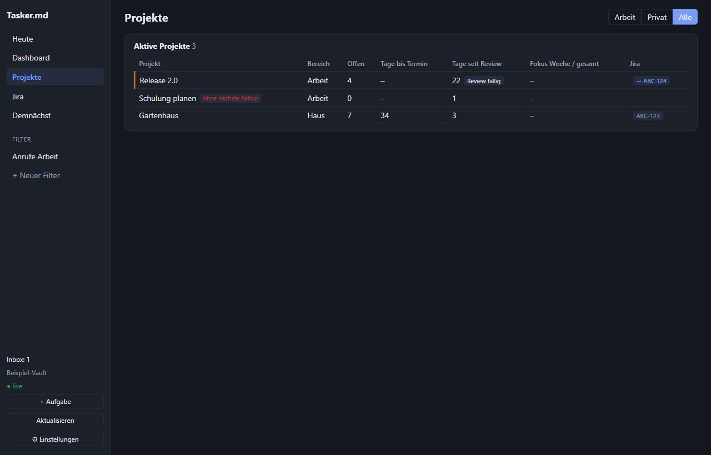

Die Tabelle zeigt deine aktiven Projekte mit:

- **Bereich** und Zahl der **offenen** Aufgaben.
- **Tage bis Termin** aus dem Frontmatter-Feld `termin`.
- **Tage seit Review** aus dem Feld `review`. Ab 14 Tagen (einstellbar) erscheint **Review fällig**.
- **ohne nächste Aktion**, wenn ein aktives Projekt keine offene Aufgabe hat. Das ist das wichtigste Warnsignal im GTD-Review.
- **Fokus** dieser Woche und gesamt (aus dem Log, siehe [Abschnitt 13](#13-fokus-timer-und-fokus-zeiten)).
- **Jira:** `→ ABC-124` heißt, das Ticket ist dem Projekt über das Feld `jira` zugeordnet. Ein graues `ABC-123` heißt, es wird im Projekt nur erwähnt.

## 8. Demnächst

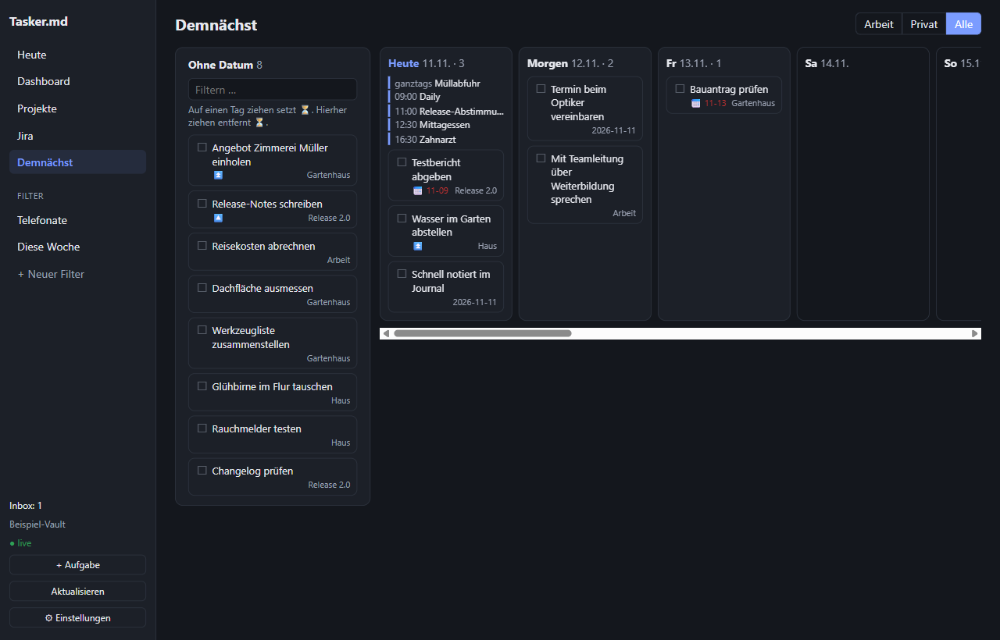

„Demnächst“ zeigt heute und die nächsten 13 Tage als Spalten, mit den Kalenderterminen oben in jeder Spalte. Links stehen die offenen Aufgaben **ohne Datum**, mit einem Suchfeld.

**Umplanen per Drag & Drop:**
- Eine Aufgabe auf einen Tag ziehen setzt `⏳` auf diesen Tag.
- Auf „Ohne Datum“ ziehen entfernt `⏳`.
- `📅` (echte Termine) ändert Drag & Drop nie.

## 9. Jira

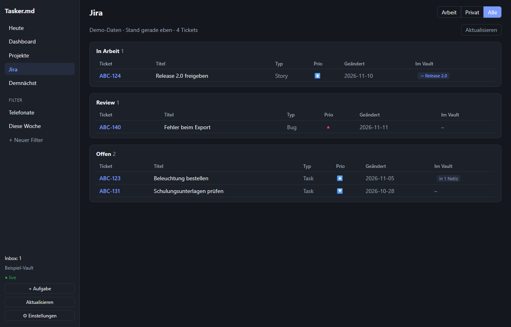

Die Jira-Ansicht zeigt deine Tickets, gruppiert nach Status. Grundlage ist die JQL-Abfrage aus den Einstellungen, Standard: alle dir zugewiesenen, nicht erledigten Tickets. Ein Klick auf den Schlüssel öffnet das Ticket in Jira.

Die Spalte **Im Vault** zeigt die Verbindung zu deinen Notizen:

- `→ Release 2.0`: Das Ticket steht im Feld `jira` dieses Projekts.
- `in 1 Notiz`: Der Schlüssel kommt im Text einer Notiz vor. Ein Klick listet die Fundstellen.

**Einrichten:**
1. In den Einstellungen, Reiter **Jira**, die **Jira-Adresse** eintragen (`https://<firma>.atlassian.net`) und unter **Projekt-Schlüssel** die Präfixe, die im Vault als Ticket erkannt werden sollen, z. B. `ABC`.
2. In der Jira-Ansicht über **Zugang …** E-Mail und [API-Token](https://id.atlassian.com/manage-profile/security/api-tokens) eintragen. Empfohlen ist ein Token mit Bereichen (Scopes), nur lesend: `read:jira-work` und `read:jira-user`.
3. Der Token wird nur im Schlüsselbund des Betriebssystems gespeichert, nie in der Konfiguration.

Läuft der Token ab, zeigt die App den letzten Stand weiter und weist auf den Ablauf hin. Tasker.md schreibt nichts nach Jira.

## 10. Aufgaben bearbeiten

### 10.1 Abhaken, planen, Priorität

Mit der Maus über die Knöpfe an der Zeile, mit der Tastatur über eine ausgewählte Aufgabe (`j`/`k` wählen aus):

| Aktion | Maus | Taste | Was in der Zeile passiert |
|---|---|---|---|
| Abhaken | Kästchen | `x` | `[x]` und ` ✅ heute` |
| Für heute planen / zurücknehmen | ⏳-Knopf | `t` | `⏳` heute setzen bzw. entfernen |
| Datum wählen | | `d` | `⏳` auf das gewählte Datum |
| Priorität | | `1` / `2` / `0` | `⏫` / `🔼` / keine |
| In Arbeit / wieder offen | | `s` | `[/]` bzw. `[ ]` |
| In Obsidian öffnen | ↗ | `o` | nichts, öffnet die Notiz |
| Fokus-Timer | ▶ | `f` | nichts (siehe [Abschnitt 13](#13-fokus-timer-und-fokus-zeiten)) |

Nach jeder Änderung erscheint unten eine Meldung mit **Rückgängig**.

**In Obsidian öffnen:**
- Ist im Vault das Community-Plugin **Advanced URI** aktiv, springt Obsidian direkt auf die Zeile der Aufgabe.
- Ohne das Plugin öffnet sich die Notiz, und der Aufgabentext liegt in der Zwischenablage. Mit `Strg+F` und `Strg+V` findest du die Aufgabe.
- Tasker.md prüft nur lesend, ob das Plugin vorhanden ist. Es installiert und ändert nichts.

### 10.2 Wiederkehrende Aufgaben

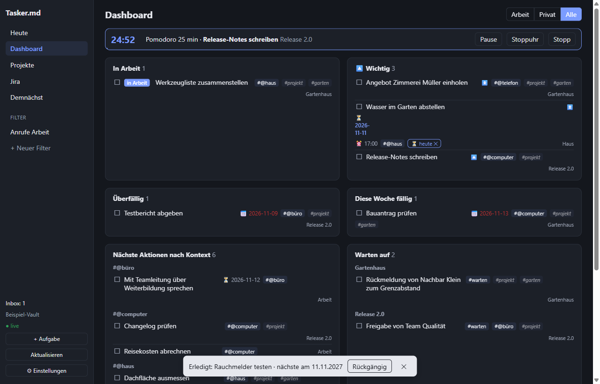

Beim Abhaken einer Aufgabe mit `🔁` legt Tasker.md wie das Tasks-Plugin die **nächste Instanz in einer neuen Zeile darüber** an. Die Meldung nennt das nächste Datum, **Rückgängig** stellt beide Zeilen wieder her.

| Regel | Bedeutung |
|---|---|
| `every day`, `every 3 days` | täglich, alle 3 Tage |
| `every week`, `every other week` | wöchentlich, alle 2 Wochen |
| `every weekday` | Montag bis Freitag |
| `every monday, thursday` | an diesen Wochentagen |
| `every 2 weeks on friday` | jeden zweiten Freitag |
| `every month`, `every month on the 15th`, `every month on the last` | monatlich, am 15., am Monatsletzten |
| `every year` | jährlich |
| … `when done` | ab dem Tag des Abhakens statt ab dem Datum |

**So entsteht die neue Instanz:**
- **Bezugsdatum:** `📅`, sonst `⏳`, sonst `🛫`. Alle Daten verschieben sich um denselben Abstand.
- **Monatsende:** Es wird gekappt, aus dem 31.01. plus einem Monat wird der 28.02.
- **Ohne jedes Datum** rechnet Tasker.md ab heute und setzt `⏳`.
- **Was sich ändert:** Die neue Zeile ist offen und hat weder `✅` noch `🆔`. Ein `➕` wird auf heute gesetzt.
- **Erinnerungen:** `⏰ HH:MM` bleibt. Ein `⏰` mit Datum wandert mit.
- **Unbekannte Regel:** Tasker.md verweigert das Abhaken mit einem Hinweis, die Datei bleibt unverändert.

### 10.3 In Arbeit

`[/]` markiert, woran du gerade sitzt. Solche Aufgaben stehen auf „Heute“ und im Dashboard ganz oben unter **In Arbeit**. Die Taste `s` schaltet um.

Auf Wunsch setzt der Fokus-Timer beim Start automatisch `[/]` (Einstellungen → Heute & Fokus).

## 11. Schnelleingabe

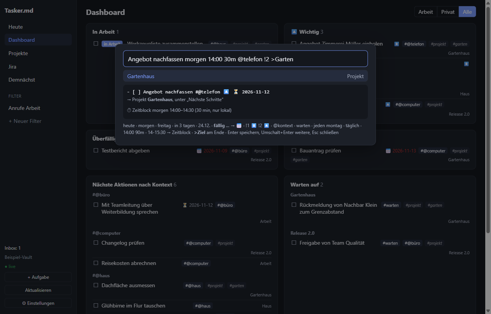

Mit `q`, mit **+ Aufgabe** oder über das globale Tastenkürzel (siehe [Abschnitt 15](#15-infobereich-autostart-und-globales-tastenkürzel)) öffnet sich ein Eingabefeld. Du schreibst in normaler Sprache. Die **Vorschau** zeigt die Zeile, die entsteht, und wohin sie kommt.

| Eingabe | Ergebnis |
|---|---|
| `heute`, `morgen`, `übermorgen`, `freitag`, `am mo`, `in 3 tagen`, `in 2 wochen`, `24.12.`, `2026-12-24` | `⏳` an diesem Tag |
| `fällig freitag`, `bis 24.12.`, `due tomorrow` | `📅` statt `⏳` |
| `!1` / `!2` / `!3` | `⏫` / `🔼` / `🔽` |
| `@telefon` | `#@telefon`, mit Vorschlägen aus deinen Kontexten |
| `warten` | `#warten` |
| `täglich`, `jeden montag`, `jede woche` | `🔁 every day` usw. |
| `14:00`, `14 Uhr`, `um 14`, `9:30` | Zeitblock ab dieser Uhrzeit |
| `14-15:30`, `14-16 Uhr` | Zeitblock mit dieser Spanne |
| `90m`, `45min`, `1h`, `1,5h`, `2h30` (nach einer Uhrzeit) | Dauer des Zeitblocks |
| `>Gartenhaus` (am Ende) | Ziel: Projekt oder Bereich, mit Vorschlägen, `Tab` übernimmt |

**Beispiel:** `Angebot nachfassen morgen 14:00 30m @telefon !2 >Garten` legt im Projekt Gartenhaus unter „Nächste Schritte“ die Zeile `- [ ] Angebot nachfassen #@telefon 🔼 ⏳ <morgen>` an und dazu einen Zeitblock morgen 14:00 bis 14:30.

**Weitere Regeln:**
- **Ohne `>Ziel`** landet die Aufgabe als neue Notiz in der Inbox.
- **Uhrzeit:** Sie steht nicht in der Zeile, Zeitblöcke sind lokal. Ohne Datum wird die Aufgabe für heute geplant.
- **Tasten:** `Enter` speichert, `Umschalt+Enter` speichert und lässt das Feld für die nächste Aufgabe offen, `Esc` schließt.
- **Rückgängig** in der Meldung entfernt die Zeile wieder, samt Zeitblock. Bei einer neuen Inbox-Notiz geht das nicht, weil Tasker.md nie Dateien löscht.

## 12. Eigene Filter

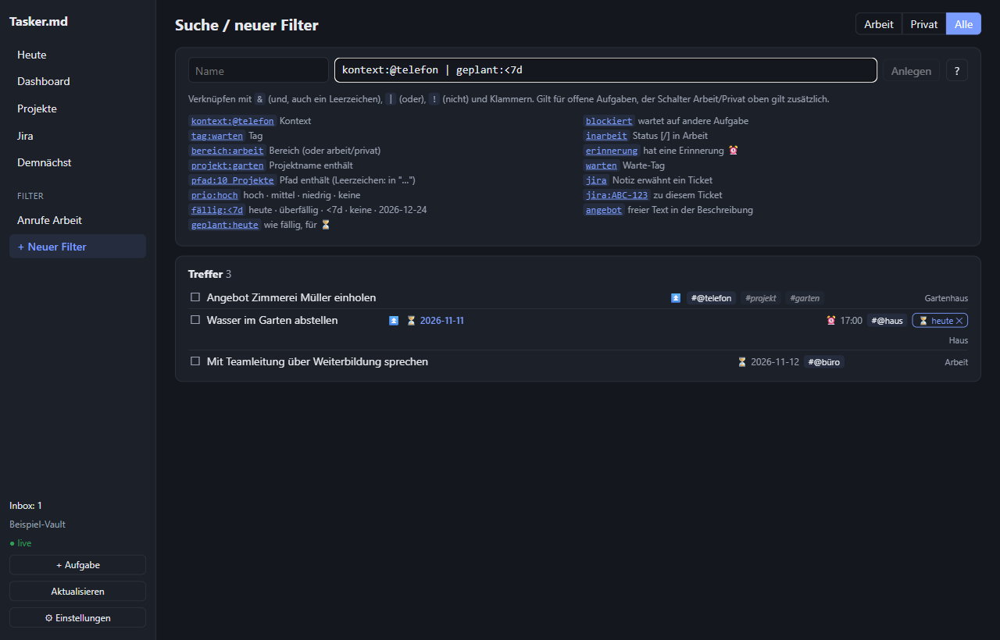

Über **+ Neuer Filter** in der Seitenleiste baust du eigene Ansichten mit einer kleinen Abfragesprache. Die Treffer erscheinen schon beim Tippen. Mit Namen und **Anlegen** wird der Filter in der Seitenleiste gespeichert.

| Begriff | findet |
|---|---|
| `kontext:@telefon` | Kontext |
| `tag:garten` | Tag, auch aus dem Frontmatter |
| `bereich:arbeit`, `bereich:privat`, `bereich:haus` | Arbeit/Privat oder Name des Bereichs |
| `projekt:garten` | Projektname enthält |
| `pfad:"10 Projekte"` | Pfad enthält |
| `prio`, `prio:hoch`, `prio:mittel`, `prio:niedrig`, `prio:keine` | Priorität |
| `fällig:heute`, `fällig:überfällig`, `fällig:<7d`, `fällig:keine`, `fällig:2026-12-24` | `📅` |
| `geplant:…` | dasselbe für `⏳` |
| `blockiert`, `warten`, `inarbeit`, `erinnerung` | Zustand |
| `jira`, `jira:ABC-123` | Notiz oder Zeile erwähnt ein bzw. dieses Ticket |
| `angebot` | freier Text in der Beschreibung |

**Verknüpfen:**
- `&` (und, auch ein Leerzeichen), `|` (oder), `!` (nicht) und Klammern.
- Werte mit Leerzeichen kommen in Anführungszeichen.
- Beispiel: `kontext:@telefon & bereich:arbeit & !blockiert`.

**Was ein Filter zeigt:** nur offene Aufgaben. Der Umschalter Arbeit/Privat oben gilt zusätzlich. Ein Fehler wird mit Position angezeigt, ein fehlerhafter Filter lässt sich nicht speichern.

## 13. Fokus-Timer und Fokus-Zeiten

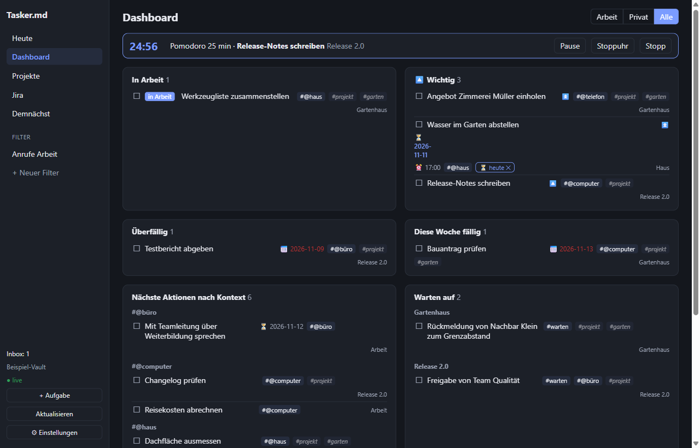

Mit `f` oder dem ▶-Knopf an einer Aufgabe bzw. einem Zeitblock startet der Fokus-Timer.

**Bedienung:**
- Standard ist ein **Pomodoro** mit 25 Minuten Arbeit und 5 Minuten Pause (einstellbar).
- **Stoppuhr** wechselt in eine freie Zeitmessung.
- **Pause** hält an, **Stopp** beendet und verbucht.
- Der Timer läuft auch im Infobereich weiter. Das Tray-Symbol zeigt die Zeit im Tooltip, das Tray-Menü hat Pause, Weiter und Stopp.
- Am Ende einer Arbeitsphase kommt eine Benachrichtigung, und in der App die Frage **Erledigt abhaken?**

**Verbuchen:**
- Jede Sitzung wird lokal gespeichert.
- Zusätzlich schreibt Tasker.md in die Projekt- bzw. Bereichsnotiz unter `## Log` **eine Zeile pro Aufgabe und Tag**, z. B. `- 2026-11-11 ⏱ 50 min (2 Sitzungen) · Release-Notes schreiben`.
- Weitere Sitzungen am selben Tag aktualisieren diese Zeile.
- Sitzungen unter 5 Minuten werden nicht geschrieben.
- Aufgaben aus der Inbox oder aus Tagesnotizen haben kein Log, ihre Zeit bleibt nur lokal.
- Das Schreiben ins Log ist abschaltbar. **Log rückgängig** in der Meldung nimmt den Eintrag zurück.

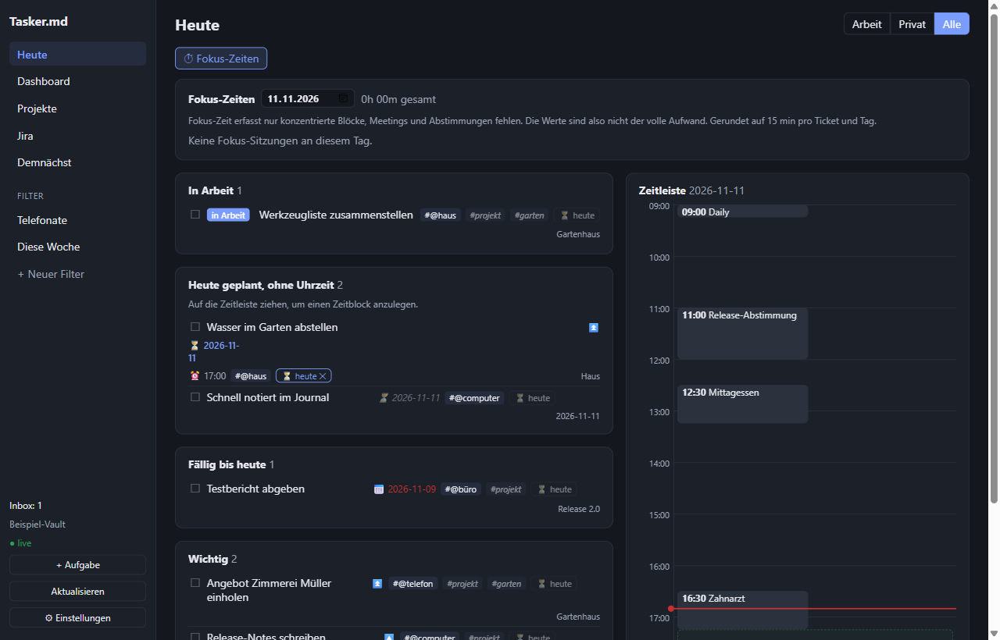

**⏱ Fokus-Zeiten** auf „Heute“ fasst einen Tag für die Zeitbuchung in Jira zusammen:

- **Gruppierung:** je Ticket, mit Summe, Zahl der Sitzungen und den beteiligten Aufgaben. Gerundet wird auf 15 Minuten (einstellbar), die Rohwerte stehen daneben.
- **Zuordnung zum Ticket:** zuerst ein Schlüssel in der Aufgabenzeile, dann das Feld `jira` des Projekts. Steht dort mehr als ein Ticket, wählst du einmal aus, und Tasker.md merkt sich die Wahl.
- **Knöpfe:** „Kopieren“ je Zeile, „Alles kopieren“, „In Jira öffnen“ und ein Haken „gebucht“, damit du siehst, was noch offen ist.
- Gebucht wird in Jira nicht automatisch.

## 14. Erinnerungen und Tagesbriefing

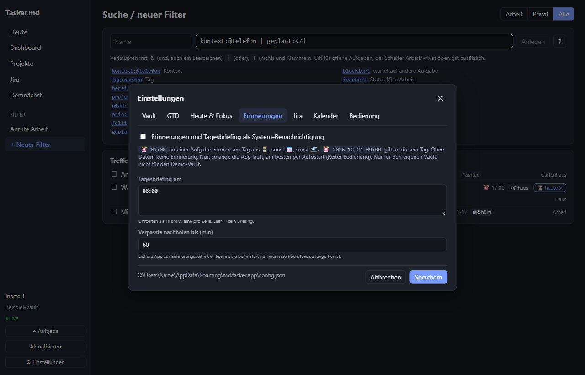

**Erinnerungen** schreibst du direkt in die Aufgabenzeile:

```markdown
- [ ] Wasser im Garten abstellen #@haus ⏫ ⏰ 17:00 ⏳ 2026-11-11
- [ ] Geschenk besorgen ⏰ 2026-12-20 10:00
```

**Wann sie kommen:**
- `⏰ 17:00` erinnert am Tag aus `⏳`, sonst `📅`, sonst `🛫`. Ohne Datum gibt es keine Erinnerung.
- `⏰ 2026-12-20 10:00` gilt an genau diesem Tag. Das ist auch das Format des Obsidian-Plugins „Reminder“.
- Mehrere `⏰` pro Aufgabe sind erlaubt.
- Der Filter `erinnerung` zeigt alle Aufgaben mit `⏰`.

**Wie sie kommen:** als System-Benachrichtigung, **solange Tasker.md läuft**, auch versteckt im Infobereich. Deshalb lohnt sich der Autostart (siehe [Abschnitt 15](#15-infobereich-autostart-und-globales-tastenkürzel)).
- Erledigte Aufgaben erinnern nicht.
- Nach einem Neustart kommt keine Erinnerung doppelt.
- Lief die App zur Erinnerungszeit nicht, kommt die Erinnerung beim nächsten Start mit dem Hinweis „war um 17:00“. Das gilt nur, wenn sie höchstens 60 Minuten her ist (einstellbar).
- Abhaken direkt aus der Benachrichtigung ist nicht möglich.

Das **Tagesbriefing** kommt zu den eingestellten Uhrzeiten (Standard 08:00) als Benachrichtigung. Beispiel: „3 geplant, 1 überfällig, 1 in Arbeit · nächster Termin 09:00 Daily · erster Zeitblock 10:00“.

## 15. Infobereich, Autostart und globales Tastenkürzel

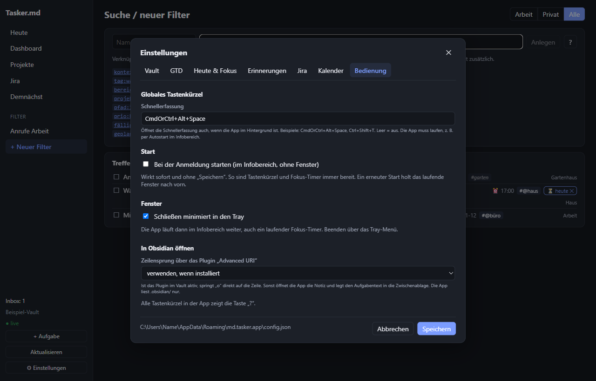

- **Infobereich (Tray):** Schließen des Fensters minimiert Tasker.md in den Infobereich bzw. die Menüleiste. Ein Klick auf das Symbol holt das Fenster zurück. Das Menü bietet „Neue Aufgabe …“, die Fokus-Steuerung und **Beenden**. Abschaltbar unter „Schließen minimiert in den Tray“.
- **Autostart:** „Bei der Anmeldung starten“ startet Tasker.md mit der Anmeldung, ohne Fenster im Infobereich.
  - Der Schalter wirkt sofort, ohne „Speichern“, und ist standardmäßig aus.
  - Unter Windows gilt der Eintrag nur für deinen Benutzer, unter macOS ist er ein LaunchAgent. Ausschalten entfernt ihn vollständig.
- **Globales Tastenkürzel:** Standard ist `Strg+Alt+Leertaste` (macOS: `Cmd+Option+Leertaste`). Es öffnet die Schnelleingabe als kleines Fenster, auch wenn Tasker.md im Hintergrund läuft. Leer lassen schaltet es ab. Ist das Kürzel schon von einem anderen Programm belegt, meldet die App das beim Start.
- **Nur eine Instanz:** Startest du Tasker.md ein zweites Mal, kommt das laufende Fenster nach vorn.

## 16. Google Kalender verbinden

Tasker.md liest deine Termine aus Google Kalender (nur lesen, die nächsten 14 Tage). Dafür legst du einmalig ein eigenes, kostenloses Google-Cloud-Projekt an, denn Tasker.md bringt keine eigenen Google-Zugangsdaten mit:

1. In der [Google Cloud Console](https://console.cloud.google.com/) ein Projekt anlegen und die **Google Calendar API** aktivieren.
2. Den OAuth-Zustimmungsbildschirm einrichten: Typ **Extern**, Bereich `.../auth/calendar.readonly`, dein eigenes Konto als **Testnutzer**.
3. Einen **OAuth-Client vom Typ „Desktop-App“** anlegen und Client-ID sowie Client-Secret kopieren.
4. In Tasker.md auf **Heute → Verbinden …** beides eintragen, **Mit Google verbinden** klicken, im Browser zustimmen und danach die Kalender auswählen.

Die ausführliche Anleitung mit allen Menüpunkten steht in der [README](../README.md#google-kalender).

**Gut zu wissen:**
- Im Google-Status „Testen“ läuft die Verbindung nach 7 Tagen ab, dann einfach neu verbinden.
- Client-Daten und Token liegen im Schlüsselbund des Betriebssystems.

## 17. Einstellungen

**⚙ Einstellungen** unten links. Änderungen gelten nach **Speichern**, außer dem Autostart.

| Reiter | Inhalt |
|---|---|
| **Vault** | Vault-Ordner und -Name, Ordnernamen, ausgeschlossene Ordner ([Abschnitt 2](#2-installation-und-erster-start)) |
| **GTD** | was als „Arbeit“ zählt, Kontexte, Warten-Tag, Review-Intervall, geerbte Tags und Datum aus Tagesnotizen |
| **Heute & Fokus** | Zeitleiste (Beginn, Ende, Blocklänge), Pomodoro-Zeiten, Log im Vault, „in Arbeit“ beim Fokus-Start |
| **Erinnerungen** | Erinnerungen an/aus, Tagesbriefing, Nachholzeitraum ([Abschnitt 14](#14-erinnerungen-und-tagesbriefing)) |
| **Jira** | Adresse, Token-Typ, JQL, Projekt-Schlüssel, Aktualisierungsintervall, Rundung ([Abschnitt 9](#9-jira)) |
| **Kalender** | Aktualisierungsintervall, Tage im Voraus |
| **Bedienung** | globales Tastenkürzel, Autostart, Tray, „In Obsidian öffnen“ ([Abschnitt 15](#15-infobereich-autostart-und-globales-tastenkürzel)) |

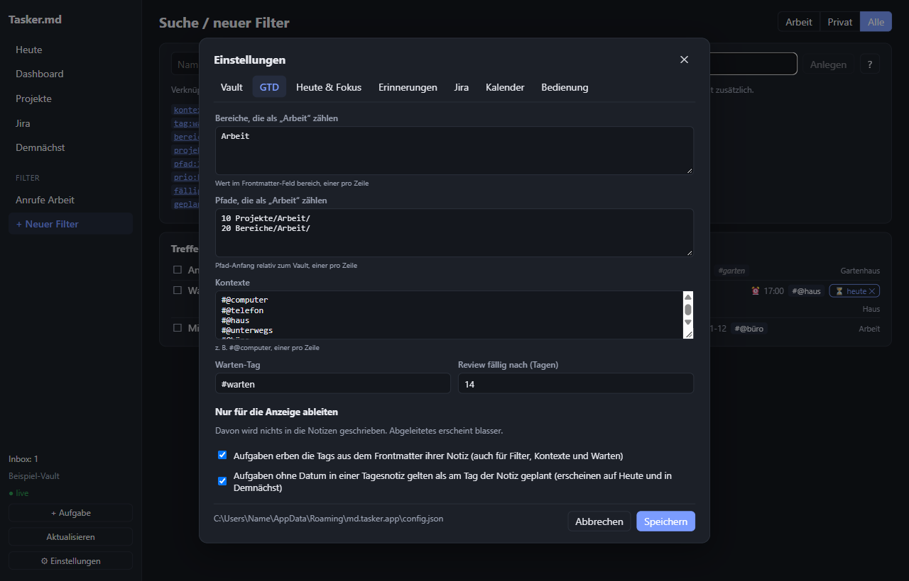

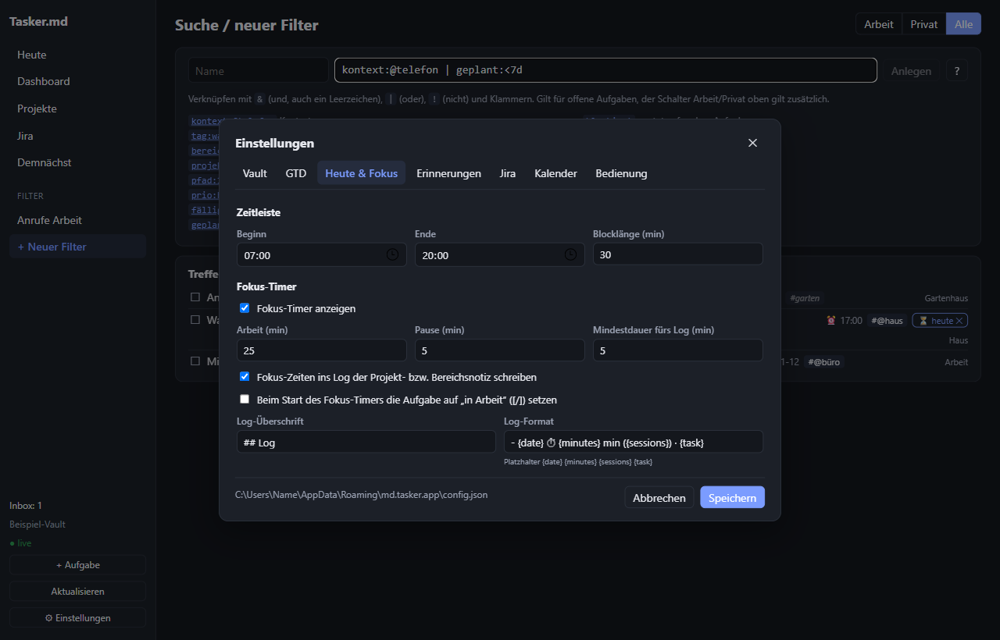

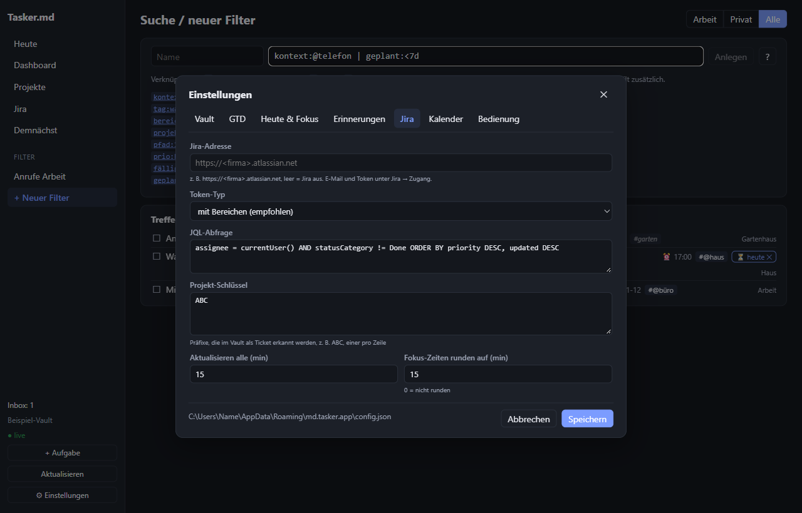

## 18. Tastenkürzel

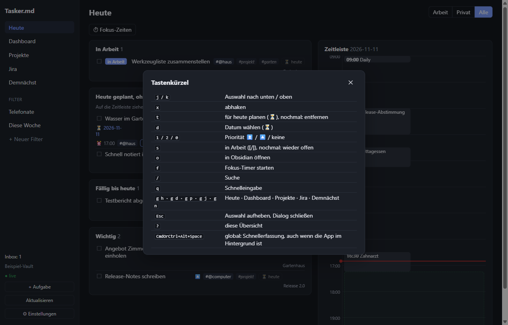

Die Taste `?` zeigt diese Übersicht jederzeit an.

| Taste | Aktion |
|---|---|
| `j` / `k` (oder Pfeiltasten) | Auswahl nach unten / oben |
| `x` | abhaken |
| `t` | für heute planen, nochmal: entfernen |
| `d` | Datum wählen (`⏳`) |
| `1` / `2` / `0` | Priorität `⏫` / `🔼` / keine |
| `s` | in Arbeit, nochmal: wieder offen |
| `o` | in Obsidian öffnen |
| `f` | Fokus-Timer starten |
| `/` | Suche |
| `q` | Schnelleingabe |
| `g h` · `g d` · `g p` · `g j` · `g n` | Heute · Dashboard · Projekte · Jira · Demnächst |
| `Esc` | Auswahl aufheben, Dialog schließen |
| `?` | Übersicht der Tastenkürzel |
| `Strg+Alt+Leertaste` (global, einstellbar) | Schnelleingabe, auch wenn die App im Hintergrund ist |

## 19. Wo liegen meine Daten?

| Was | Wo |
|---|---|
| Aufgaben, Projekte, Fokus-Log | in deinem Vault, als normale Markdown-Zeilen |
| Konfiguration | `config.json` im App-Datenordner |
| Zeitblöcke, Fokus-Zeiten, bereits gezeigte Erinnerungen | `timeblocks.json`, `focus.json`, `reminders.json` im App-Datenordner |
| Jira- und Kalender-Cache | `jira-cache.json`, `calendar-cache.json` im Cache-Ordner |
| Jira-Token, Google-Zugang | Schlüsselbund des Betriebssystems (Windows-Anmeldeinformationen bzw. macOS-Schlüsselbund) |

| | App-Datenordner | Cache-Ordner |
|---|---|---|
| Windows | `%APPDATA%\md.tasker.app` | `%LOCALAPPDATA%\md.tasker.app` |
| macOS | `~/Library/Application Support/md.tasker.app` | `~/Library/Caches/md.tasker.app` |

Tasker.md sendet keine Telemetrie. Netzwerkzugriffe gibt es nur zu Jira und Google, und nur, wenn du sie einrichtest.

## 20. Häufige Fragen

**Eine Aufgabe erscheint nicht.**
- Liegt die Notiz in einem ausgeschlossenen Ordner (Einstellungen → Vault → Nicht scannen)?
- Steht die Zeile wirklich als `- [ ] Text`, mit Leerzeichen im Kästchen?
- Erledigte und abgebrochene Aufgaben (`[x]`, `[-]`) werden nicht angezeigt.
- Unter „Arbeit“ oder „Privat“ fehlt sie vielleicht nur wegen des Umschalters oben rechts. Probiere „Alle“.

**Unter „Arbeit“ ist alles leer.**
Es sind noch keine Arbeitsbereiche eingetragen. Trage sie ein unter Einstellungen → GTD → „Bereiche, die als Arbeit zählen“ oder „Pfade, die als Arbeit zählen“.

**„Die Zeile hat sich geändert“ beim Abhaken.**
Die Notiz wurde seit dem letzten Laden geändert, z. B. in Obsidian oder durch die Synchronisation. Tasker.md hat nichts geschrieben und neu geladen. Einfach noch einmal versuchen.

**Wiederkehrende Aufgabe lässt sich nicht abhaken.**
Die Regel nach `🔁` ist unbekannt. Die Meldung nennt den Regeltext. Unterstützt sind die Regeln aus [10.2](#102-wiederkehrende-aufgaben).

**Erinnerungen kommen nicht.**
- Läuft Tasker.md? Am besten den Autostart einschalten.
- Hat die Aufgabe ein Datum (`⏳`, `📅` oder `🛫`) oder ein `⏰` mit Datum?
- Sind Erinnerungen in den Einstellungen eingeschaltet?
- Sind Benachrichtigungen für Tasker.md im Betriebssystem erlaubt?

**Das globale Tastenkürzel geht nicht.**
Ein anderes Programm nutzt dieselbe Kombination. Wähle in Einstellungen → Bedienung eine andere, z. B. `Ctrl+Shift+T`.

**Kalender zeigt „nicht verbunden“ oder alte Termine.**
Im Google-Status „Testen“ läuft die Verbindung nach 7 Tagen ab. Neu verbinden über Heute → Kalender ….

**Jira meldet „Token erneuern“.**
Der API-Token ist abgelaufen oder ungültig. Lege einen neuen an und trage ihn in der Jira-Ansicht unter Zugang … ein.
